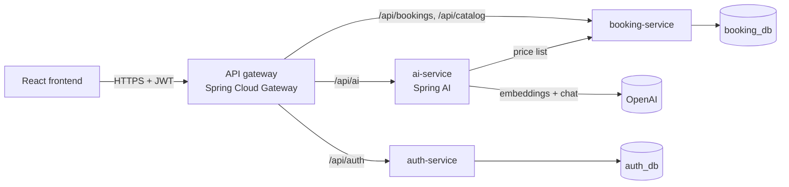

# AutoCare AI

A car workshop platform where customers describe a problem in plain English, get the likely cause and a price from an AI assistant, and book the right service. Mechanics run their day from a job board, and customers follow their car through each stage of the work.

Built as **Spring Boot microservices** behind an **API gateway**, with **Spring AI** answering questions using retrieval-augmented generation (RAG) over the workshop's own guide and price list, and a **React** frontend.


## What it does

- **AI car assistant:** "There's a grinding noise when I brake" → likely cause, safety advice, the matching service and its price range, with a one-click "Book this" button.
- **Bookings:** customers pick a service, their car and a day, then track progress: Booked → In progress → Ready to collect → Collected.
- **Workshop job board:** mechanics move jobs between stages and leave notes the customer sees.
- **Roles:** customer, mechanic and admin, enforced at the gateway and in each service.
- **Works without an AI key:** if no OpenAI key is set, or the AI provider is down, the assistant falls back to keyword search over the same guide.

## Architecture



| Service | Port | Responsibility |
|---|---|---|
| `api-gateway` | 8080 | Single entry point. Routes requests, validates JWTs, strips spoofed identity headers, rate-limits the AI endpoint, handles CORS. |
| `auth-service` | 8081 | Registration, login, BCrypt password hashing, JWT issuing, login lockout after repeated failures. |
| `booking-service` | 8082 | Service catalog and price list, bookings, and the job status workflow. |
| `ai-service` | 8083 | Spring AI assistant: retrieves the most relevant sections of the workshop guide, then asks the model to answer using only those notes and the live price list. |
| `frontend` | 5173 | React + Vite single-page app. |

Each service has its own database (database-per-service), and services only talk to each other over HTTP.

More detail: [docs/ARCHITECTURE.md](docs/ARCHITECTURE.md)

## Tech stack

**Backend:** Java 21, Spring Boot 3.4, Spring Cloud Gateway, Spring AI 1.0 (OpenAI chat + embeddings), Spring Data JPA, PostgreSQL, JJWT, Maven
**Frontend:** React 18, React Router, Vite, Vitest + Testing Library
**DevOps:** Docker, Docker Compose, GitHub Actions CI

## Run it locally

### Option 1: Docker (everything in one command)

You need [Docker Desktop](https://www.docker.com/products/docker-desktop/).

```bash
cp .env.example .env        # then set JWT_SECRET (and OPENAI_API_KEY if you have one)
docker compose up --build
```

Open http://localhost:5173.

### Option 2: run each service yourself

You need Java 21, Maven and Node 22. Each Java service uses an in-memory H2 database by default, so no database setup is needed.

```bash
cd auth-service    && mvn spring-boot:run   # port 8081
cd booking-service && mvn spring-boot:run   # port 8082
cd ai-service      && mvn spring-boot:run   # port 8083 (set OPENAI_API_KEY for AI mode)
cd api-gateway     && mvn spring-boot:run   # port 8080
cd frontend        && npm install && npm run dev   # port 5173
```

### Demo accounts

| Role | Email | Password |
|---|---|---|
| Customer | customer@autocare.demo | Customer123! |
| Mechanic | mechanic@autocare.demo | Mechanic123! |
| Admin | admin@autocare.demo | Admin123! |

## API

All requests go through the gateway on port 8080.

| Method | Path | Who | Description |
|---|---|---|---|
| POST | `/api/auth/register` | Public | Create a customer account, returns a JWT |
| POST | `/api/auth/login` | Public | Log in, returns a JWT |
| GET | `/api/auth/me` | Logged in | Current user |
| GET | `/api/catalog` | Public | Services and price ranges |
| POST | `/api/ai/diagnose` | Public (rate-limited) | Ask the assistant about a car problem |
| GET | `/api/ai/status` | Public | Whether the assistant is in AI or offline mode |
| POST | `/api/bookings` | Customer | Book a service |
| GET | `/api/bookings/mine` | Customer | My bookings |
| POST | `/api/bookings/{id}/cancel` | Customer (owner) | Cancel a booking that hasn't started |
| GET | `/api/bookings?status=` | Mechanic, admin | All jobs |
| PATCH | `/api/bookings/{id}/status` | Mechanic, admin | Move a job to its next stage |

## Security

- Passwords hashed with **BCrypt** (cost 12). Registration always creates customers, so roles can't be self-assigned.
- **JWT** access tokens (HS256, 2-hour expiry) signed by auth-service and checked at the gateway.
- The gateway **removes any `X-User-*` headers sent by clients** before adding its own, so users can't impersonate each other.
- **Login lockout:** 5 failed attempts locks the email for 5 minutes. Error messages don't reveal whether an email exists.
- **Rate limiting** on the AI endpoint (10 requests per minute per user or IP) to control cost and abuse.
- **Prompt-injection hardening:** messages are capped at 500 characters, the system prompt tells the model to ignore instructions inside customer messages, and answers are grounded in retrieved notes.
- Customers can only see and cancel their own bookings. Other bookings return 404, not 403, so their existence isn't revealed.
- Containers run as a **non-root user**. Secrets come from environment variables, never from the code.

## Tests

```bash
mvn verify                      # all Java services (from the project root)
cd frontend && npm test         # React tests
```

GitHub Actions runs every test on each push.

## Project structure

```
autocare-ai/
├── api-gateway/        Spring Cloud Gateway: routing, JWT filter, rate limiter
├── auth-service/       users, login, JWT
├── booking-service/    catalog, bookings, job workflow
├── ai-service/         Spring AI assistant + workshop knowledge base
├── frontend/           React app
├── docker/             database setup
├── docs/               architecture notes
└── docker-compose.yml
```

## What I'd add next

- Swap the in-memory rate limiter for Redis so the gateway can scale to several instances
- Email or WhatsApp notifications when a car is ready
- Store embeddings in PGVector instead of memory
- Service discovery with Eureka and distributed tracing

---

Built by **James Oliveira** · [Portfolio](https://james1oliveira.github.io) · [LinkedIn](https://www.linkedin.com/in/james-oliveira-158280346)
